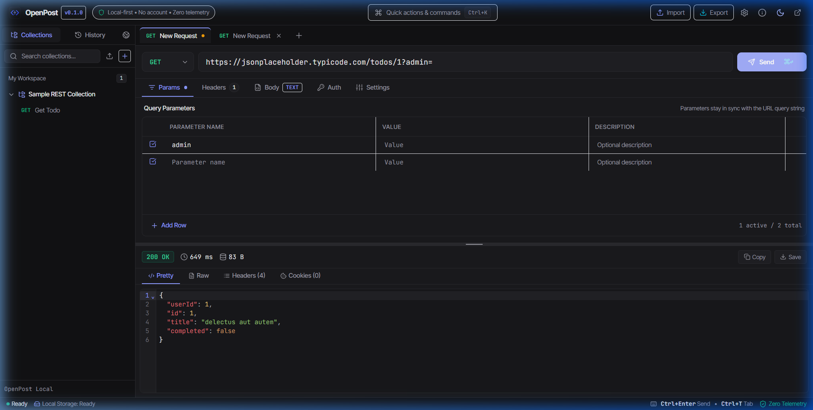
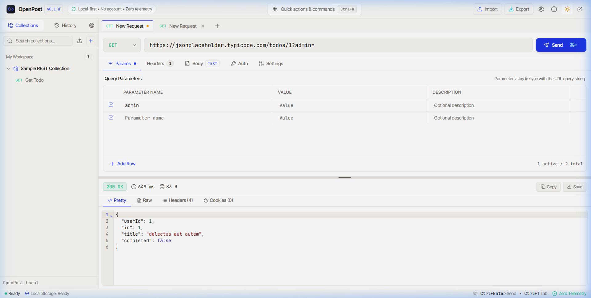
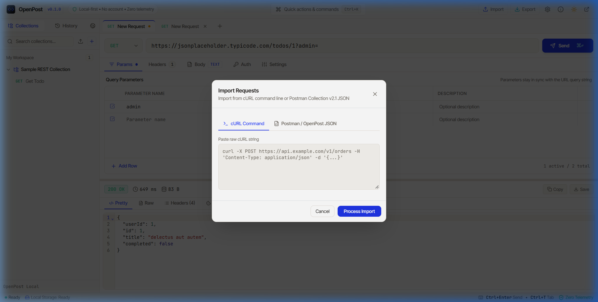
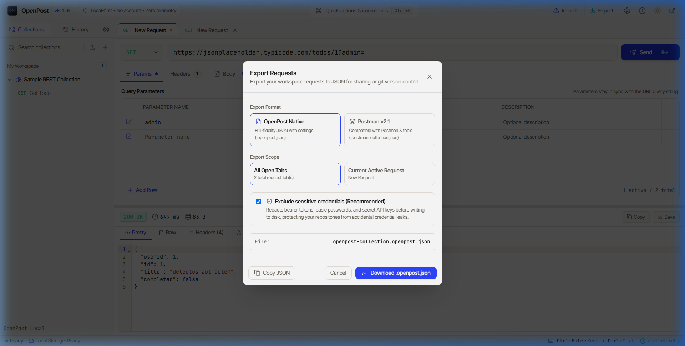
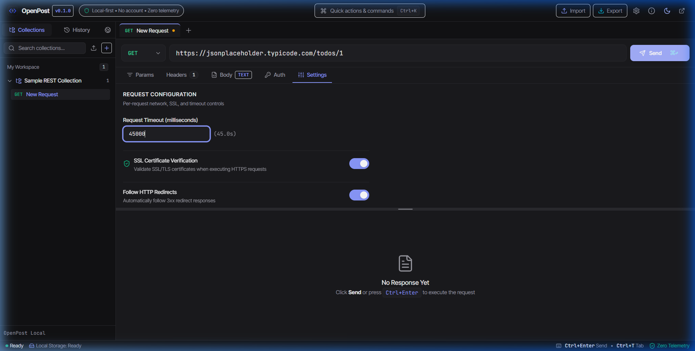

<p align="center">
  
</p>

<h1 align="center">OpenPost</h1>

<p align="center">
  <strong>The free, open-source Postman alternative. No account. No limits. Fully local.</strong>
</p>

<p align="center">
  <a href="https://github.com/azlanabdulla/OpenPost/releases"></a>
  <a href="https://github.com/azlanabdulla/OpenPost/actions/workflows/ci.yml"></a>
  <a href="LICENSE"></a>
  
  
</p>

<p align="center">
  <a href="https://github.com/sponsors/azlanabdulla"></a>
</p>

<p align="center">
  <a href="#about-openpost">About</a> •
  <a href="#screenshots">Screenshots</a> •
  <a href="#features">Features</a> •
  <a href="#download--installation">Download</a> •
  <a href="#quick-start">Quick Start</a> •
  <a href="#how-to-use">How-To Guide</a> •
  <a href="#keyboard-shortcuts">Shortcuts</a> •
  <a href="#data-storage--privacy">Privacy & Data</a> •
  <a href="#comparison">Comparison</a> •
  <a href="#troubleshooting--faq">FAQ</a> •
  <a href="#support-openpost">Support</a> •
  <a href="#build-from-source">Build from Source</a>
</p>

---

## About OpenPost

**OpenPost** is a fast, lightweight, and completely local API client designed for software engineers, QA testers, and security researchers who want the developer ergonomics of a modern REST client without forced logins, paywalls, or cloud surveillance. Built with **Tauri 2**, **Rust**, and **React 19**, OpenPost executes requests natively on your operating system with zero browser CORS barriers, lightning-fast startup times, and minimal memory usage.

Unlike commercial tools that require cloud accounts, transmit proprietary API keys to third-party servers, and enforce artificial team limits, OpenPost is strictly local-first. All workspaces, collections, environments, and history records live on your local machine in human-readable JSON files and SQLite databases. You retain 100% ownership of your developer data.

---

## Screenshots

<div align="center">
  <p><strong>Dark Theme (Calm Obsidian)</strong></p>
  
</div>

<br />

<div align="center">
  <p><strong>Light Theme (Editorial Canvas)</strong></p>
  
</div>

<br />

<table align="center" width="100%">
  <tr>
    <td width="50%" align="center">
      <strong>Collection Import & Flag Audit</strong><br/><br/>
      
    </td>
    <td width="50%" align="center">
      <strong>Secret-Scrubbed Export</strong><br/><br/>
      
    </td>
  </tr>
  <tr>
    <td colspan="2" align="center">
      <strong>Request Configuration & Boundary-Validated Timeout</strong><br/><br/>
      
    </td>
  </tr>
</table>

---

## Features

### 🚀 High-Performance Request Engine
- **HTTP Methods**: Full support for `GET`, `POST`, `PUT`, `PATCH`, `DELETE`, `HEAD`, and `OPTIONS`.
- **Zero CORS**: Desktop requests execute directly via Rust's asynchronous `reqwest` engine, completely bypassing browser CORS restrictions.
- **Bi-Directional Query Sync**: Edits in the URL query string update the query parameters table instantly, and vice versa.
- **Multiple Payload Types**: Raw JSON (with real-time syntax validation), Plain Text, `x-www-form-urlencoded`, and Multipart Form-Data.
- **Authentication Helpers**: Bearer Token, HTTP Basic Auth, API Key (Header or Query), and **Auth Inheritance** from parent collections and folders.
- **Per-Request Controls**: Plain numeric text inputs for request timeouts (100 ms to 10 min) with default fallback (30s) and inline validation. One-click self-signed SSL certificate bypass.

### 📊 Deep Response Inspection
- **CodeMirror 6 JSON Viewer**: Syntax highlighting, collapsible code folding, search, and bracket matching.
- **Rich Media & Binary Preview**: Inline visual preview for binary image responses (PNG, JPEG, SVG, WebP) and intact binary file downloads.
- **Decompression**: Automatic transparent decoding of GZIP, Deflate, and Brotli compression streams.
- **Cookie Inspector**: Dedicated Cookies tab parsing multi-`Set-Cookie` headers with expiration, path, and security flags.
- **Sandboxed HTML Preview**: Isolated `<iframe>` preview configured with `sandbox=""` and a restrictive Content Security Policy.
- **Large Payload Guard**: Warns on responses exceeding 5MB to preserve UI performance, with quick options to view truncated preview or download the raw payload.

### 📁 Collections, Workspaces & Virtualization
- **1,000+ Request Virtualization**: High-performance virtualized list rendering keeps memory usage minimal and animations at 60 FPS even with thousands of endpoints.
- **Hierarchical Folders**: Organize requests in unlimited nested folders with dedicated folder descriptions and inheritances.
- **Multi-Tab Workspace**: Tab strip with dirty-state indicators (`●`), unsaved changes protection, and 3-action close confirmation (`Save`, `Don't Save`, `Cancel`).

### 🔒 Privacy, Security & Secrets
- **Local SQLite History**: Persistent request history stored in a local SQLite database (`history.db`) with automatic secret scrubbing (`[REDACTED]` for Authorization headers, cookies, and secret tokens).
- **Zero Telemetry**: Completely devoid of analytics pings, user tracking, advertising IDs, or telemetry services.
- **OS Keychain Integration**: Sensitive authentication tokens can be secured via your operating system's native credential store (Windows Credential Manager, macOS Keychain, Linux Secret Service).
- **Atomic File Writing**: Tab drafts and collections write to temporary files before atomically replacing destinations (`.tmp` -> `.json` with `.bak` safety copies).

### 🔄 Import & Export Interoperability
- **Postman v2.1 Import**: Seamlessly import Postman Collection JSON files with folder structures and requests intact.
- **cURL Command Import**: Paste raw cURL commands from your terminal, browser DevTools, or documentation.
- **Unsupported Flag Reporting**: Dedicated audit dialog highlights unsupported command-line flags (e.g. `--limit-rate`, `--socks5`) before importing.
- **Sanitized Exports**: Export in OpenPost Native (`.openpost.json`) or Postman Collection v2.1 (`.postman_collection.json`) formats with automatic secret stripping.

### 🎨 Inclusive Design & Accessibility
- **Dual WCAG 2.1 AA Themes**: Hand-crafted Light and Dark palettes verified with automated contrast testing across all text, borders, focus rings, placeholders, and status badges.
- **Bidirectional & RTL Text**: Native support for right-to-left scripts (Arabic, Hebrew, Persian) in text inputs and textareas.
- **Reduced Motion**: Full support for OS-level `prefers-reduced-motion` settings.

---

## Download & Installation

Download the official standalone installer or package for your operating system from [GitHub Releases](https://github.com/azlanabdulla/OpenPost/releases):

| Operating System | Package Format | Architecture |
| :--- | :--- | :--- |
| **Windows** | `.msi` (Installer), `.exe` (NSIS) | x86_64 / x64 |
| **macOS** | `.dmg` | Universal (Apple Silicon & Intel) |
| **Linux** | `.AppImage`, `.deb` | x86_64 |

### Unsigned Installer Notice
OpenPost is an independent open-source project. Because we do not charge for subscriptions or collect user data, commercial code-signing certificates are not purchased:

- **Windows**: Microsoft Defender SmartScreen may display *"Windows protected your PC"*. Click **More info**, then select **Run anyway**.
- **macOS**: Apple Gatekeeper may notify you that the app is from an unidentified developer. Right-click `OpenPost.app`, select **Open**, and click **Open**. Alternatively, run:
  ```bash
  xattr -cr /Applications/OpenPost.app
  ```
- **Linux**: For AppImage packages, mark the file as executable before launching:
  ```bash
  chmod +x OpenPost-*.AppImage
  ./OpenPost-*.AppImage
  ```
- **Integrity Verification**: SHA-256 checksums are published in the release notes for every release. Verify your download on Windows PowerShell with:
  ```powershell
  Get-FileHash -Algorithm SHA256 .\OpenPost_0.1.0_x64-setup.exe
  ```

---

## Quick Start

Get productive with OpenPost in under two minutes:

1. **Send Your First Request**:
   Enter `https://jsonplaceholder.typicode.com/posts/1` into the URL bar and press **Ctrl+Enter** (or click **Send**). Observe the formatted JSON response and timing statistics.
2. **Add Headers & Query Parameters**:
   Switch to the **Params** tab to add key-value pairs (e.g., `limit = 10`), or open **Headers** to choose presets like `+Accept: application/json`.
3. **Use Environment Variables**:
   Define `{{baseUrl}}` in your environment or collection variables. In the URL bar, type `{{baseUrl}}/users/1`. OpenPost resolves variable hierarchies automatically before dispatch.
4. **Configure Authentication**:
   Select the **Auth** tab. Choose **Bearer Token**, enter your token, and click the eye icon to verify masked characters.
5. **Import a cURL Command**:
   Click the **Import** button in the sidebar (or press **Ctrl+K** and select *Import cURL / Postman*). Paste your cURL command directly to create a pre-configured request tab.

---

## How-To Guide

### 1. Variables & Precedence Hierarchy
OpenPost resolves variables dynamically across request URLs, query parameters, request headers, payload bodies, and authentication credentials. When identical variable names exist in multiple scopes, OpenPost enforces this strict precedence order (OP-R2-019):

```
Request Variables  (Highest Precedence)
       ↓
Folder Variables
       ↓
Environment Variables
       ↓
Collection Variables
       ↓
Global Variables   (Lowest Precedence)
```

- **Cycle Detection**: Circular references (e.g., `a: "{{b}}"`, `b: "{{a}}"`) are detected automatically before sending (`OP-VAR-002`). OpenPost halts the request and alerts you with the exact circular chain.
- **Undefined Variables**: If template tokens like `{{undefinedKey}}` are detected before dispatch, a warning modal prompts you with the missing tokens, allowing you to *Send Anyway* or *Cancel*.

### 2. Authentication & Auth Inheritance
- **Inherit from Parent**: Set a request's auth type to **Inherit Auth**. OpenPost automatically inherits the Bearer Token, Basic Auth, or API Key configured on its enclosing collection or folder.
- **Credential Masking & Storage**: Secrets are masked on screen and automatically excluded from workspace exports by default. Secrets persist across application restarts on **Windows only** (via native Windows Credential Manager). On **macOS and Linux**, credentials remain securely held in memory for the active session and do not persist across restarts (displaying the `OP-SEC-002` notification). Seamless cross-platform persistence via the `keyring` crate is planned on the roadmap.

### 3. Request History & Secret Scrubbing
- **Automatic History**: All executed requests are logged into your local SQLite database (`history.db`).
- **Secret Scrubbing**: Values for `Authorization`, `Cookie`, and URL tokens matching keys like `api_key`, `secret`, or `password` are sanitized to `[REDACTED]` prior to SQLite write operations.
- **Restoration**: Click any historical entry in the History panel to restore it into your active tab or a new tab.

### 4. Importing & Exporting
- **Importing cURL**: Open the Import modal, paste your command, and click *Process Import*. If the command contains CLI-only arguments (e.g., `--limit-rate`), OpenPost presents an *Unsupported-Flag Report* explaining which flags were omitted.
- **Exporting Collections**: Click the Settings / Export icon, select **OpenPost Native** (`.openpost.json`) or **Postman v2.1** (`.postman_collection.json`), and toggle **Exclude Secrets**.

---

## Keyboard Shortcuts

| Shortcut (Windows / Linux) | Shortcut (macOS) | Action |
| :--- | :--- | :--- |
| **Ctrl + Enter** | **Cmd + Enter** | Send active request / Cancel if loading |
| **Ctrl + T** | **Cmd + T** | Open a new request tab |
| **Ctrl + W** | **Cmd + W** | Close active tab (triggers save prompt if dirty) |
| **Ctrl + K** | **Cmd + K** | Open Command Palette |
| **Escape** | **Escape** | Close open modal or dialog |
| **Tab / Shift + Tab** | **Tab / Shift + Tab** | Trap and cycle focus inside active modal |

---

## Data Storage & Privacy

OpenPost guarantees that **no telemetry, usage metrics, or background network calls** will ever occur. OpenPost makes no network calls except the requests you send. The sponsor and GitHub links open in your browser only when you click them. Network connections are initiated solely when you explicitly click **Send** or click an external repository link.

### File Storage Locations
All configurations, persistent history, and drafts are stored locally:

- **Windows**: `%APPDATA%\com.openpost.app\`  
  *(e.g., `C:\Users\<User>\AppData\Roaming\com.openpost.app\`)*
- **macOS**: `~/Library/Application Support/com.openpost.app/`
- **Linux**: `~/.local/share/com.openpost.app/`

### Key Files
- `history.db`: Local SQLite database containing request/response logs with scrubbed secrets.
- `openpost_draft_tabs_v1.json`: Local workspace tab state.
- `openpost_draft_tabs_v1.bak`: Rolling backup copy for automatic corruption recovery.

---

## Known Limitations

- **Secret Persistence Across Restarts**: Sensitive credentials (auth tokens, passwords, API keys) persist across application restarts on **Windows only** (backed by native Windows Credential Manager). On **macOS and Linux**, secrets are held securely in memory for the duration of the active session and do not persist across restarts (displaying the amber `OP-SEC-002` notification). Migration to the cross-platform `keyring` crate (supporting macOS Keychain and Linux Secret Service) is scheduled for v0.2.0.
- **WebSocket & GraphQL**: OpenPost v0.1.0 is specialized for REST/HTTP APIs. Interactive WebSocket inspectors and GraphQL schema discovery are planned for v0.3.0.
- **Pre-request & Test Assertion Scripts**: Postman JavaScript scripts are omitted because OpenPost executes securely without an embedded arbitrary JavaScript sandbox runtime.

---

## Comparison

| Capability | OpenPost | Traditional Commercial Clients |
| :--- | :---: | :---: |
| **Account Required** | ❌ **Never (No sign-up)** | ⚠️ Mandatory account & login |
| **Request & Collection Limits** | ❌ **Unlimited** | ⚠️ Artificial tier restrictions |
| **Cloud Synchronization** | ❌ **100% Local-first** | ⚠️ Forced cloud syncing of workspaces |
| **Secret Security** | 🔒 **WinCred / In-Memory (macOS/Linux)** | ⚠️ Synced to external cloud servers |
| **Telemetry & Trackers** | ❌ **Zero telemetry** | ⚠️ Extensive behavioral tracking |
| **CORS Limitations** | ❌ **Zero CORS (Rust backend)** | ❌ None |
| **Lightweight Desktop Core** | ⚡ **Tauri 2 (~15MB RAM idle)** | ⚠️ Electron (often 300MB+ RAM) |
| **License** | **Free & Open Source (MIT)** | Closed-source commercial |

---

## Troubleshooting & FAQ

### Why did my request fail with an SSL certificate error?
If testing against local endpoints or staging APIs with self-signed certificates, open the **Settings** tab within your request builder and toggle off **SSL Certificate Verification**.

### Does OpenPost enforce CORS restrictions?
No. In the desktop application, all network traffic is dispatched through Rust's native `reqwest` HTTP client, which operates independently of browser sandbox restrictions.

### Why does my Request Timeout reset if I enter an invalid number?
Request timeouts must be between `100` and `600,000` milliseconds (10 minutes). If a value outside this range is entered, an inline warning is shown and the client safely defaults to 30,000 ms.

### For additional error codes:
Please consult our complete error reference in [docs/ERROR_CODES.md](docs/ERROR_CODES.md).

---

## Build from Source

### Prerequisites
1. **Node.js**: v20 or newer with `npm`
2. **Rust**: Stable toolchain (`rustup default stable`)
3. **Platform Dependencies**:
   - **Windows**: Visual Studio 2022 C++ Build Tools & WebView2 runtime.
   - **macOS**: Xcode Command Line Tools.
   - **Linux**: `libwebkit2gtk-4.1-dev`, `build-essential`, `curl`, `libssl-dev`.

### Build Instructions

```bash
# 1. Clone the repository
git clone https://github.com/azlanabdulla/OpenPost.git
cd OpenPost

# 2. Install dependencies
npm ci

# 3. Verify TypeScript types and run test suite
npm run typecheck
npm test

# 4. Verify WCAG contrast audit
node scripts/verify_contrast.cjs

# 5. Launch local desktop development environment
npm run tauri dev

# 6. Build production installer
npm run tauri build
```

---

## Project Structure

```
OpenPost/
├── .github/workflows/       # GitHub Actions CI and Release pipelines
├── docs/                    # Documentation, error codes, screenshots, QA checklists
│   └── screenshots/         # Curated application screenshots for README
├── public/                  # Static assets and embedded web fonts
├── scripts/                 # Contrast verification and network monitor tools
├── src/                     # React 19 Frontend application
│   ├── components/          # Reusable UI components, modals, and builders
│   ├── editor/              # CodeMirror 6 syntax-highlighted editor
│   ├── stores/              # Zustand global state (request, history, theme, toast)
│   ├── types/               # TypeScript interface and type definitions
│   └── utils/               # URL parser, variable resolver, exporter, cURL parser
├── src-tauri/               # Rust Desktop Backend (Tauri 2)
│   ├── src/                 # Request executor, SQLite history engine, atomic drafts
│   ├── tests/               # Backend Rust integration and unit tests
│   └── tauri.conf.json      # Desktop security CSP and bundle configuration
└── tests/                   # Vitest unit, regression, and E2E test suites
```

---

## Contributing & Roadmap

We welcome issues and pull requests from the developer community!
- Please read our [CONTRIBUTING.md](CONTRIBUTING.md) guide before submitting patches.
- To report security concerns, refer to [SECURITY.md](SECURITY.md).

### Roadmap ("Later" List)
- [ ] WebSocket and Server-Sent Events (SSE) live streaming tabs
- [ ] GraphQL query builder with schema introspection
- [ ] gRPC protobuf client integration
- [ ] Built-in lightweight mock server runner
- [ ] CLI runner for automated CI/CD collection execution

---

## Support OpenPost

OpenPost is free and open source, and it always will be — no paywalls, no artificial limits, and no accounts. Sponsoring is completely optional and goes directly toward ongoing maintenance, platform bug fixes, and purchasing official desktop code-signing certificates for Windows and macOS.

If OpenPost helps you in your development work, consider [sponsoring on GitHub](https://github.com/sponsors/azlanabdulla). Starring the [OpenPost repository](https://github.com/azlanabdulla/OpenPost), reporting bugs, and contributing improvements also help the project tremendously.

---

## License & Acknowledgements

OpenPost is released under the **[MIT License](LICENSE)**.

Special thanks to the [Tauri](https://tauri.app/), [React](https://react.dev/), [CodeMirror](https://codemirror.net/), and [Lucide](https://lucide.dev/) open-source communities.
